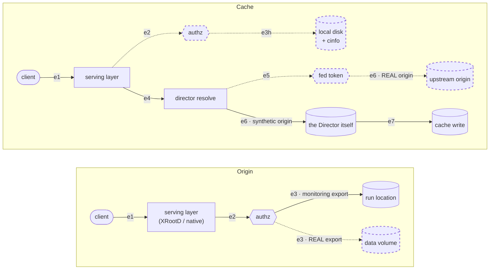
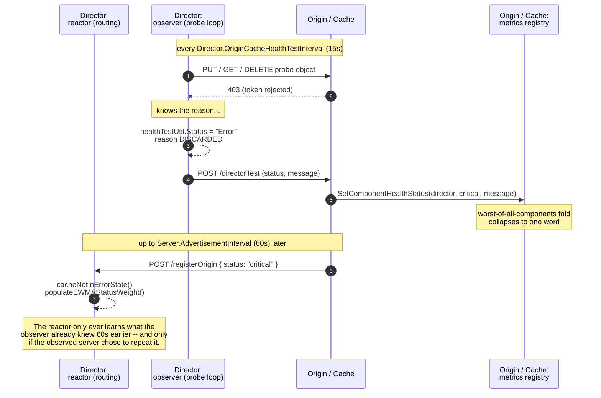
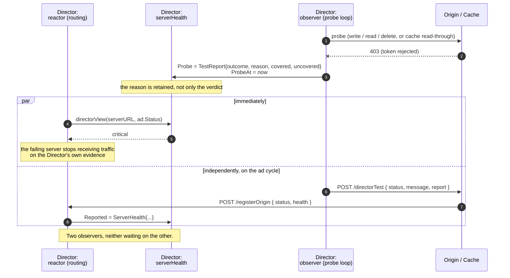
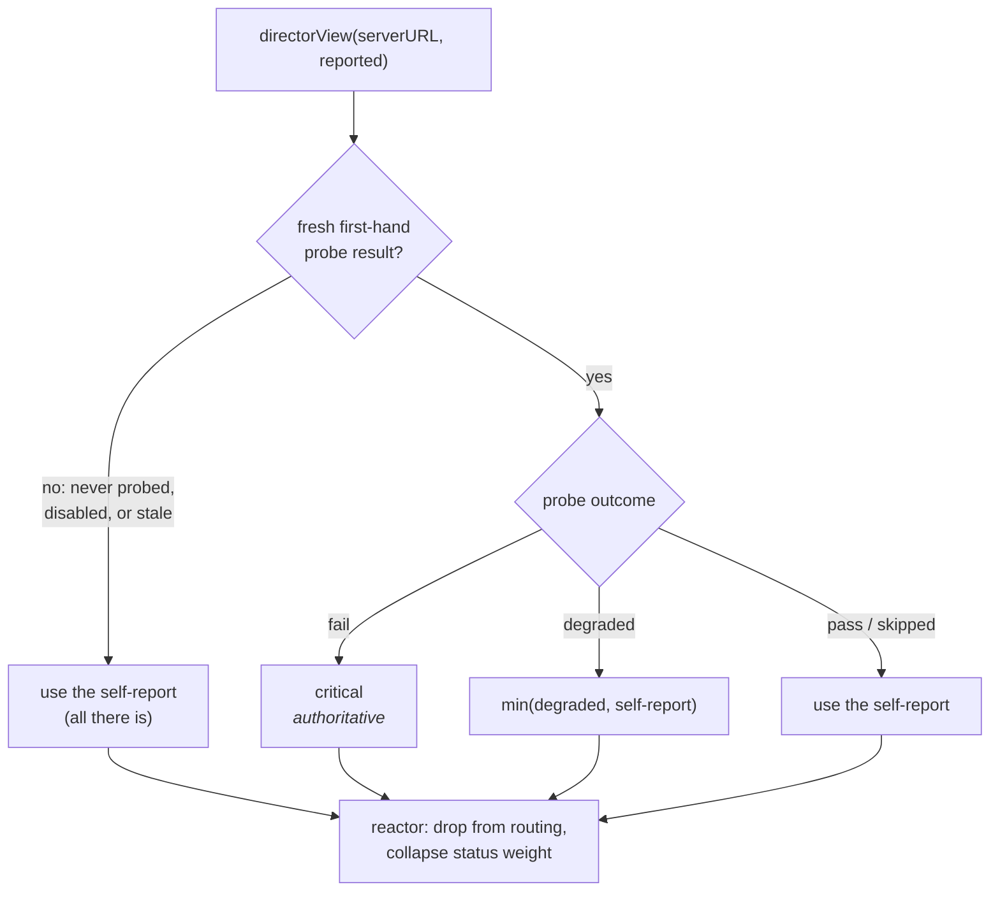
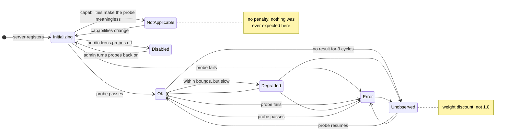

# Origin and Cache Health Testing Design

## 1. Overview

An Origin or a Cache does not have "health" of its own. It is a proxy for a storage resource, and what can actually fail is the *relationship* between the service and that resource: the data path, the authorization chain, the backend credentials, the upstream fetch. A health probe is meaningful only to the extent that it traverses that relationship the same way a client request does.

Today nothing in the codebase names that relationship. `server_utils.OriginExport` carries the namespace, the storage prefix, and the capabilities, but the authorization context is scattered across `xrootd/authorization.go` and the issuer configuration, and the serving layer is inferred from `Origin.StorageType`. Because the relationship is unnamed, no code can ask whether a probe covers it — and working the answer out by hand shows that, for the paths that matter most, it does not.

This document does three things:

1. Formalizes the service–storage relationship as a set of **bindings**, and the operations on them as **paths** made of independently-failing **edges** (§2).
1. Measures what the four existing probes actually cover against that model, and names the holes (§3).
1. Uses the gray-failure model of Huang et al. to state the class of bug being fixed, then proposes a design against it (§4–§11).

The design goal, stated once: **shrink the region in which a client can fail while the Director sees green.**

Three open issues — [#3095](https://github.com/PelicanPlatform/pelican/issues/3095) (origins that disable director tests show up red), [#3107](https://github.com/PelicanPlatform/pelican/issues/3107) (test transfer utilities need cleanup), and [#2713](https://github.com/PelicanPlatform/pelican/issues/2713) (tests should key off capabilities, not storage backend) — fall out of this model as instances rather than as three separate pieces of work. They are treated that way here.

### 1.1 Non-goals

- Replacing Prometheus metrics or the `metrics` package's component-health registry. The component registry stays; it gains a transport and a vocabulary, not a replacement.
- Building a general alerting or paging system. This design makes the signal available and correct; what an operator does with it is out of scope.
- Probing paths a client cannot reach. A probe that tests something no client depends on adds cost and no coverage.

## 2. The service–storage relationship

### 2.1 Bindings

A **binding** is the unit that fails independently:

```
B = ⟨ N, R, S, A, C ⟩

  N   federation namespace prefix    /ligo/frames
  R   storage resource               POSIX directory | S3 bucket | Globus collection | pstore |
                                     SSH host | (for a cache) its upstream origin set
  S   serving layer                  XRootD, or the native pelican handler
  A   authorization context          issuer keys, scitokens.cfg / authfile, backend credentials,
                                     federation token
  C   capability set                 reads | writes | listings | public-reads | direct-reads
```

A data server publishes a *set* of bindings: one per export, plus one for `/pelican/monitoring`. Two bindings on the same server can fail independently — a credential that expires for one S3 bucket, an NFS mount that drops for one export, an issuer key rotation that invalidates one namespace. A single per-server health value cannot represent that, which is the root of §4.

The absence of this tuple in the code is why `config.go` reaches for `Origin.StorageType` as a proxy for "can we test this": the storage *type* is the only part of the binding the code can currently name.

### 2.2 Paths and edges

For an operation `op ∈ {read, write, delete, list, stat}` on a binding `B`, the **path** `P(B, op)` is an ordered sequence of **edges**. An edge is a dependency that fails on its own.

**Origin:**

```
client ──e1──▶ S ──e2──▶ authz decision ──e3──▶ R
       TLS/HTTP       scitokens/authfile     syscall | S3 API | Globus API |
       front          + issuer trust         SSH channel | pstore block store
```

**Cache.** The cache path *bifurcates on cache state*, and the two branches share almost nothing. This has no analogue on the origin side and is the single most important structural fact in this document:

```
HIT    client ──e1──▶ S ──e2──▶ authz ──e3h──▶ local disk + cinfo ──▶ bytes

MISS   client ──e1──▶ S ──e2──▶ authz ──e4──▶ director resolve
                                         ──e5──▶ federation token mint / present
                                         ──e6──▶ upstream origin fetch
                                         ──e7──▶ local disk write ──▶ bytes
```

Edges `e4` through `e7` exist only on the miss path. A probe that happens to land on a hit says nothing whatsoever about any of them.

Overlaying which probe reaches which edge makes the shape of the problem visible — the dashed edges are the ones no probe traverses:



Solid edges are probed today. Dashed edges are not, and every one of them is on the path a real client takes.

`e5` deserves particular attention: it is the cache obtaining a federation token and presenting it to a token-required origin. That is the mechanism behind `CacheAuthz`, which is the only feature registered in `features/features.go`.

### 2.3 Why this framing and not "components"

The `metrics` package already has a component registry (`xrootd`, `cmsd`, `federation`, `director`, …). Components answer "which subsystem of this process is unwell". Bindings answer "which of the things this server promises to do is broken". They are different questions, and only the second is what a client experiences or what the Director needs in order to route.

Components remain useful and are retained. This design adds bindings alongside them.

## 3. Coverage of the existing probes

This section describes the state *before* this design, and is retained as the diagnosis the rest of the document argues from. Where a hole has since been closed, §7 says so and names the stage.

Four probes existed. Each was written against a specific symptom rather than against a model, so their union was smaller than it appeared.

| Probe            | Implementation                                                          | What it does                                                                                                        |
| ---------------- | ----------------------------------------------------------------------- | ------------------------------------------------------------------------------------------------------------------- |
| Origin self-test | `xrootd/self_monitor.go` → `server_utils.TestFileTransferImpl.RunTests` | PUT/GET/DELETE under `/pelican/monitoring/selfTest/`, token issued by the origin's own `Server.ExternalWebUrl`      |
| Director→origin  | `director/monitor.go`                                                   | The same probe with a federation-issued token, falling back to a director-issued one for legacy origins             |
| Cache self-test  | `xrootd/self_monitor.go` `generateTestFile`                             | Writes the object **and a hand-fabricated `.cinfo`** straight to `Cache.NamespaceLocation`, then GETs it            |
| Director→cache   | `director/cache_monitor.go` `runCacheTest`                              | Unauthenticated GET; the cache misses and fetches from a synthetic public-read origin that is *the Director itself* |

### 3.1 The coverage matrix

| Edge                                            | Origin self | Director→origin |   Cache self   | Director→cache | **Real client** |
| ----------------------------------------------- | :---------: | :-------------: | :------------: | :------------: | :-------------: |
| `e1` TLS/HTTP front                             |      ✓      |        ✓        |       ✓        |       ✓        |        ✓        |
| `e2` authz — local monitoring issuer            |      ✓      |        —        |       ✓        |       —        |        —        |
| `e2` authz — federation issuer                  |      —      |        ✓        |       —        |  n/a (public)  |        ✓        |
| `e2` authz — **real namespace issuer**          |      ✗      |        ✗        |       —        |       —        |        ✓        |
| `e3` origin data plane — monitoring export      |      ✓      |        ✓        |       —        |       —        |        —        |
| `e3` origin data plane — **real export**        |      ✗      |        ✗        |       —        |       —        |        ✓        |
| `e3h` cache hit path                            |      —      |        —        |       ~        |       —        |        ✓        |
| `e4` cache miss — director resolve              |      —      |        —        |       ✗        |       ✓        |        ✓        |
| `e5` cache miss — **federation token**          |      —      |        —        |       ✗        |       ✗        |        ✓        |
| `e6` cache miss — **real upstream origin**      |      —      |        —        |       ✗        |       ✗        |        ✓        |
| `e7` cache miss — disk write / cinfo generation |      —      |        —        | ✗ (fabricated) |       ✓        |        ✓        |

Every ✗ in a row whose client column is ✓ is, by construction, a region where a client can observe failure and no probe can.

### 3.2 Hole A — the origin probe never touches the admin's storage

This is verified in the code, not inferred:

- `xrootd/xrootd_config.go` symlinks each real export from `<Origin.RunLocation>/export/<FederationPrefix>` to `export.StoragePrefix`, then sets `oss.localroot` to `<Origin.RunLocation>/export`.
- `origin/origin_api.go` `ConfigureXrootdMonitoringDir` creates `<Origin.RunLocation>/export/pelican/monitoring` as a **real directory**, not a symlink.
- `xrootd/resources/xrootd-origin.cfg` says so outright in a comment: *"Bypass POSC for monitoring paths so that self/director test files are written directly (they live on a different filesystem in K8s)."*

So on a POSIX origin, both the self-test and the director test write to the **run location**. Neither ever touches the data volume.

Unmount the data volume, remount it read-only, fill it, break its permissions, or lose the Ceph/NFS mount behind it, and every probe still passes. The origin continues to advertise `ok` while every client request fails. This is the largest gray-failure surface in the system today, and it is load-bearing in production.

### 3.3 Hole B — the cache self-test does not test caching

`generateTestFile` fabricates the `.cinfo` that XRootD's pfc layer would normally produce, writes both files to disk with `os.OpenFile`, and reads one back over HTTPS. It establishes that XRootD can serve a file that someone already placed on disk. It does not exercise `e4`–`e7`, and because the cinfo is synthetic it does not exercise real cinfo generation either.

### 3.4 Hole C — the authenticated miss path has no coverage at all

The director→cache probe is a public read against the Director's own synthetic origin. No probe anywhere mints a federation token, presents it to a real origin, and confirms that a cache can populate a protected namespace. For a system whose one registered feature is `CacheAuthz`, that is the wrong path to have left unprobed.

### 3.5 A related inconsistency

`OriginStorageType.SupportsSelfTest()` returns true for `posixv2` and `pstore`, so `config.go` leaves `Origin.SelfTest` and `Origin.DirectorTest` enabled for them. But `PeriodicSelfTest` is launched only inside `if useXRootD` in `launchers/origin_serve.go`, and those backends are served natively. They are therefore marked testable, never self-tested, and still director-tested.

The three predicates in `server_structs/origin.go` — `SupportsSelfTest`, `IsPosixLike`, `UsesXRootD` — each answer a different question and are being used interchangeably at the call sites.

## 4. Gray failure: the class of bug

Huang et al., [*Gray Failure: The Achilles' Heel of Cloud-Scale Systems*](https://www.microsoft.com/en-us/research/wp-content/uploads/2017/06/paper-1.pdf) (HotOS '17), define gray failure as a form of **differential observability**:

> a system is defined to experience gray failure when at least one app makes the observation that system is unhealthy, but observer observes that system is healthy.

Their entities map onto Pelican directly:

| Paper        | Pelican                                                                                                                                        |
| ------------ | ---------------------------------------------------------------------------------------------------------------------------------------------- |
| **system**   | the federation data plane                                                                                                                      |
| **app**      | a client performing a transfer. Per §3.1 of the paper, *"one system may be an app for another system"* — so a **cache is an app of an origin** |
| **observer** | the self-tests and director tests                                                                                                              |
| **reactor**  | the Director's `filteredServers`, `cacheNotInErrorState`, and the EWMA `StatusWeight`                                                          |

The paper's Table 1 gives four quadrants: both healthy; **app bad / observer good, which is gray failure**; observer bad / app good (proactive, or a false positive); and both bad, which is fail-stop. Its temporal claim is that real failures walk from the first quadrant through the second to the fourth — *latent failure*, then *gray failure*, then *complete failure* — and that the observer only notices at the end.

Pelican's current health model can express the first and fourth quadrants. It has no representation for the second at all, and it treats the third as an error.

### 4.1 Eight gray-failure surfaces in the current design

**GF-1 · Scope mismatch.** The observer probes `⟨/pelican/monitoring, run-location, …⟩`; the app uses `⟨/real/ns, data-volume, …⟩`. Different `R`, different `A`. This is Hole A: the observer is measuring a different system than the one being used.

**GF-2 · Path bifurcation.** The cache observer only ever takes the hit branch or the unauthenticated miss branch. This is Holes B and C.

**GF-3 · The reactor is driven by the observed party.** The Director runs a probe, computes the reason, POSTs it to the origin, and **discards its own copy** — `healthTestUtil` stores a bare `Status` and nothing else. The origin folds the result into its `director` component, which folds into `GetHealthStatus().OverallStatus`, which becomes one word on the next advertisement up to a minute later, which is what the reactor finally reads. If the origin is an older version, drops the POST, or simply does not echo it, the Director's own first-hand observation never reaches the Director's own reactor.

This is the paper's §3.4 vicious loop rendered in code: the reactor acts on a signal that has been round-tripped through the component being judged.



Every path by which that echo can fail is a path by which a server the Director has watched fail keeps its full routing weight: an origin older than the `status` field (added in 7.17), a dropped POST, a server that reports its own health optimistically, or simply the next advertisement not having happened yet.

**GF-4 · Singular rather than multi-dimensional.** The paper's §4.1 recommendation is verbatim what is missing: *"moving from singular failure detection (e.g., with heartbeats) to multi-dimensional health monitoring."* `GetHealthStatus` min-folds every component to one word and the advertisement ships that word. No probe records latency, so the *degraded* middle of the latent → gray → complete progression is unrepresentable: a cache serving at 1 MB/s passes identically to one serving at 1 GB/s.

**GF-5 · Absence of observation is encoded as observation of health.** `StatusUnknown` is numerically 6, greater than `StatusOK` at 5, so the min-fold in `GetHealthStatus` silently ignores it; and `getRawStatusWeight` maps it to weight `1.0`.

Both choices are deliberate and documented. `getRawStatusWeight` carries an explicit comment that the weight *"is only meant to decrease a server's priority, never increase it"*, and that assigning the multiplicative identity to "unknown" is the option that does not affect sorting. Within a single scalar that conflates load and health, that reasoning is sound: a status you did not measure should not be allowed to promote a server above its peers.

The problem is the missing third option. With only "penalize" and "do nothing" available, unobserved necessarily collapses onto observed-healthy, and a server nobody is watching is routed to exactly as if it had been verified. That is what makes #3095 feel wrong in both directions at once — the reporter wants origins not to be penalized for a legitimate opt-out *and* caches not to profit from one, and the current representation cannot express both. §10 adds the third option rather than re-tuning the constant.

**GF-6 · The app's view is computed and thrown away.** Pelican already classifies app-side failures precisely — `Transfer.OriginUnresponsive`, `Transfer.OriginSlow`, `Transfer.CacheOverloaded`, `Transfer.ChecksumMismatch` in `docs/error_codes.yaml` — on every client transfer, and none of it reaches server health. The paper's §4.2 advises *approximating* app views because measuring them is usually infeasible; Pelican is in the unusual position of being able to observe them directly.

**GF-7 · Aggregation happens before the detector sees anything.** Worst-of-all-components at the server, then one word on the wire, then a scalar threshold at the reactor. The paper's §4.3 warns that placing aggregation *"too close to the core"* limits what can be observed. Pelican aggregates at the core, twice, before anything crosses a process boundary.

**GF-8 · Redaction widens the gap deliberately.** An origin-side opt-out for sharing failure detail is, in the paper's terms, an intentional increase in differential observability. It is a legitimate policy choice — not every origin is operated by the federation administrator — but it must be bounded, or it becomes an unbounded license to look green.

### 4.2 The expanded bug class

In one sentence: **any code path a client depends on that no probe traverses, and any signal a probe produces that the reactor cannot see.**

The three issues are instances:

| Issue | Reported symptom                                                   | Underlying surface                                                                            |
| ----- | ------------------------------------------------------------------ | --------------------------------------------------------------------------------------------- |
| #2713 | AWS public-data origins stuck critical                             | GF-1 — the probe plan is derived from storage *type* instead of from the binding              |
| #3095 | Origins that disable tests show red; caches that disable them hide | GF-5 — there is no state for "unobserved", and no cost attached to it                         |
| #3107 | Duplicated, interface-less probe utilities                         | The mechanical consequence of never naming the binding, so each probe re-derives its own path |

And it adds work those issues do not mention, which is where the actual availability win is: probe the real export (Hole A), probe the cache miss path (Hole B), probe an authenticated miss (Hole C), let the Director act on its own observation (GF-3), carry latency so `degraded` becomes reachable (GF-4), make uncertainty cost something in routing (GF-5), and eventually feed client-observed outcomes back into health (GF-6).

## 5. Probes make coverage claims, not verdicts

The load-bearing idea of the design: **a result names the binding and the edges it covered.** A pass that does not say what it covered is exactly how GF-1 hides.

New `server_structs/health.go`:

```go
type Edge string        // "front" | "authz" | "origin-data" | "cache-hit" |
                        // "director-resolve" | "fed-token" | "upstream-fetch" | "cache-write"
type TestOutcome string // "pass" | "degraded" | "fail" | "skipped"

type BindingRef struct {
    Namespace   string `json:"namespace"`         // the prefix actually probed
    StorageKind string `json:"storageKind"`
    Issuer      string `json:"issuer,omitempty"`  // which trust chain was exercised
    Synthetic   bool   `json:"synthetic"`         // true for /pelican/monitoring
}

type TestResult struct {
    Binding    BindingRef        `json:"binding"`
    Edges      []Edge            `json:"edges"`   // what this step actually traversed
    Op         string            `json:"op"`      // read | write | delete | list | stat
    Outcome    TestOutcome       `json:"outcome"`
    Reason     TestFailureReason `json:"reason,omitempty"`
    Detail     string            `json:"detail,omitempty"`    // free text; dropped when redacted
    HTTPStatus int               `json:"httpStatus,omitempty"`
    LatencyMs  int64             `json:"latencyMs,omitempty"` // makes "degraded" reachable
    At         int64             `json:"at"`
}

type TestReport struct {
    Suite     TestSuite    `json:"suite"`
    Outcome   TestOutcome  `json:"outcome"`
    Covered   []Edge       `json:"covered"`   // union over Results
    Uncovered []Edge       `json:"uncovered"` // expected for this role, minus Covered
    Results   []TestResult `json:"results"`
    At        int64        `json:"at"`
}
```

`Uncovered` is the field that does the real work. It turns a blind spot into a value the Director can display, alert on, and weight, instead of something an operator has to reconstruct by reading source.

A single shared classifier replaces the stringly-typed `"ok"` / `"error"` currently re-validated by hand in `director/monitor.go` and twice in `server_utils/monitor.go`, neither of which can express "skipped":

```go
func ClassifyTestError(err error, resp *http.Response) (TestFailureReason, string)

// not-applicable | disabled | redacted | connection | timeout | authorization |
// not-found | server-error | content-mismatch | storage | internal
```

## 6. One probe engine, planned from bindings

New `server_utils/health_probe.go` replaces `server_utils/test_file_transfer.go` and the duplicated halves of `xrootd/self_monitor.go` and `director/cache_monitor.go`:

```go
type ProbeStep struct {
    Op    string
    Edges []server_structs.Edge
}

type ProbePlan struct {
    Binding  server_structs.BindingRef
    BaseURL  *url.URL
    Audience string
    Issuer   string      // "" => federation-issued, with the legacy fallback
    Steps    []ProbeStep
    Seed     ProbeSeeder // the cache self-test fabricates its object locally
}

func (p ProbePlan) Run(ctx context.Context) server_structs.TestReport
```

Plans are derived from bindings, which is #2713 stated correctly: *probe the binding the client uses*, with capabilities deciding which operations are legal.

```go
func PlanOriginProbes(exports []server_utils.OriginExport, st server_structs.OriginStorageType) []ProbePlan
func PlanCacheProbes(ad server_structs.ServerAd, nsAds []server_structs.NamespaceAd) []ProbePlan
```

| Binding state                                | Plan                                                                                       |
| -------------------------------------------- | ------------------------------------------------------------------------------------------ |
| Writable namespace                           | `write → read → delete` in `/pelican/monitoring` (synthetic), plus the sentinel read below |
| Readable namespace with a `SentinelLocation` | `read` of that object, on the **real** binding                                             |
| Readable, no sentinel declared               | no plan; surfaced by `UnprobedExports` and left in `Uncovered` — never `fail`              |
| Neither reads nor writes                     | no plan; `skipped` / `not-applicable`                                                      |

The Director's half of the same rule is `OriginProbeSteps`, which returns no steps at all for an origin advertising no write capability. This is the direct fix for #2713: the storage technology is never consulted, so a writable S3 origin is as probeable as a writable POSIX one, and a read-only origin of any backend is no longer sent a PUT that was certain to fail. With no runnable step the report folds to `skipped`, which is not a failure — so those origins stop showing red for declining to do something they never advertised.

Correspondingly, `config.go` no longer force-rewrites either `Origin.DirectorTest` or `Origin.SelfTest` to `false` for non-POSIX backends. Both gates are gone: the storage type is no longer consulted anywhere in the decision to probe.

`Origin.SelfTest` does still carry a second meaning — it governs whether XRootD exports the monitoring prefix at all (`xrootd-origin.cfg`) — so an administrator who disables it on an XRootD-fronted origin loses the synthetic probe along with the local loop. That overloading is untidy but no longer blocking, because the two probe kinds are complementary (§16) and a natively-served origin does not use the monitoring export in the first place. Decoupling them is follow-up work, noted in §17.5.

Several long-standing defects disappear as a consequence of this shape rather than being fixed individually, which closes #3107:

- The `TestFileTransfer` interface is deleted. Nothing implements it, and its `RunTests` declares three parameters where the implementation takes five.

- `Run` returns a report rather than `(bool, error)`. That single change removes the dead `!ok && err == nil` branch in `doSelfMonitorCache`, the nil dereference in `doSelfMonitorOrigin` (which calls `err.Error()` in a branch reachable with `err == nil`), and the bug in `runDirectorTestCycle` where a server whose `Type` is neither origin nor cache reports `"ok"` without any test having run.

- The federation-issuer → external-web-URL token fallback becomes one documented helper instead of being copy-pasted into `uploadTestfile`, `downloadTestfile`, and `deleteTestfile`.

- `ProbeSeeder` names the genuinely cache-specific machinery — cinfo fabrication and the `FileCopyToXrootdDir` drop-privileges path — and hands it to the shared engine, so only the seeding stays special-cased and the read, cleanup, classification, and reporting are common.

  It stays in `xrootd/` rather than moving to `cache/`. The `xrootd` → `cache` dependency is not an artifact of this file: `xrootd/authorization.go` and `xrootd/xrootd_config.go` import `cache` too, and the seeder needs `xrootd.FileCopyToXrootdDir`, so moving it would introduce a genuine import cycle. Untangling that is separate work and is not required for a single probe engine.

- The duplicated constants collapse: `selfTestBody` versus `SelfTestBody`, and `selfTestDir` versus the inline `path.Join(MonitoringBaseNs, "selfTest")`. The hardcoded `User-Agent: pelican-director/…` sent even when an origin is the caller is corrected.

### 6.1 Scope relativity belongs in a type, not in a convention

A WLCG scope's resource is resolved *relative to the base path its issuer is registered under*. The string that belongs on the wire is therefore never the path the author of a probe is thinking about, and the subtraction has to happen exactly once — not zero times, not twice.

Getting it wrong is silent. `token_scopes.NewResourceScope` will build whatever it is handed, the serving layer resolves it against the base path, and the request is refused for a path nobody ever wrote down. That is [#3136](https://github.com/PelicanPlatform/pelican/issues/3136): the cache self-test requested `storage.read:/pelican/monitoring/selfTest` against an issuer already based at `/pelican/monitoring`, so XRootD looked for authority over `/pelican/monitoring/pelican/monitoring/selfTest`. It went unnoticed for as long as the cache authfile still permitted public reads of that namespace, because the broken token was not what answered the request.

The instructive part is that this bug **survived a rewrite of this entire subsystem**. The rule was understood — it is written out in a comment at the origin call site — and the cache call site two files away was still wrong. A convention that every call site has to remember is not a fix; it is the same bug waiting for the next call site.

So the rule moved into the type:

- `ProbeScope.Path` is documented as **absolute**, and every plan states the path it actually means.
- `ProbeAuth.IssuerBasePath` records where the issuer is based.
- `ProbeAuth.resourceScopes` performs the subtraction, once, at mint time.
- A path outside the issuer's base path is a hard error rather than a silently wrong scope. The issuer has no authority there, so there is no correct token to mint, and failing loudly costs one probe cycle where the quiet version cost a release.
- `ProbePlan.ResolvedScopes` exposes the wire form, so packages that *build* plans can assert on what a probe will ask for without needing a signing key.

`TestEveryPlanScopesRelativeToItsIssuer` then asserts the property over every plan constructor rather than over one call site, which is the part that makes a *new* constructor unable to reintroduce the bug quietly.

## 7. Closing the coverage holes

This is the part that is new capability rather than restructuring, and it is where the gray-failure surface actually shrinks.

**Hole A — probe the real export.** The machinery already existed and was being thrown away. `CheckOriginSentinelLocations` in `server_utils/origin.go` performs exactly the needed read — against the export's declared `SentinelLocation`, with a correctly scoped token — but only once, at startup, and it discards the answer instead of reporting it as health. An export whose volume unmounts an hour after boot passed its startup check and goes on passing every monitoring probe, because the monitoring probe never touches that volume.

`RealExportProbePlans` turns that one-shot check into a periodic, health-reporting probe: one read per export that declares a sentinel, on a **non-synthetic** binding. This reuses a field administrators already configure rather than introducing `NamespaceAd.ProbeObject`, which is what #2713 gestured at by analogy anyway.

Only reads are planned, and only where the administrator has already named an object. Writing scratch objects into a production namespace is considerably more intrusive than writing to the run location and is not something to begin doing implicitly; exports wanting a write probe get one through the monitoring namespace.

The `/pelican/monitoring` probe is retained as a separate result marked `Synthetic: true`, and **a synthetic binding cannot claim `EdgeOriginData`**. That single rule is what makes the coverage ledger honest: an origin that probes only its monitoring namespace now reports the storage edge as uncovered, instead of reporting a clean pass for the one namespace no client reads. Exports with neither a sentinel nor write capability are surfaced by `UnprobedExports` rather than passing silently.

**Hole B — probe both branches of the cache path.** The Director's cache probe now reads the same object twice. The first read names an object carrying a fresh timestamp, so the cache cannot already hold it and must take the miss branch: `e4` resolve, `e6` fetch from the Director's synthetic origin, `e7` commit to disk. The second read asks for that same object, now resident, and is served off local disk against the cinfo the cache generated itself — `e3h`, the hit branch.

Reading twice is what closes the hole rather than merely relocating it. A single cold read covers `e4`–`e7` and says nothing about `e3h`; a cache self-test covers a *seeded* `e3h` with a hand-fabricated cinfo and says nothing about `e4`–`e7`. Neither alone would have caught the production failure in [#3503](https://github.com/PelicanPlatform/pelican/issues/3503), where fetches through caches broke for hits only: the self-test's fabricated cinfo is not the artifact that was failing. The warm read exercises real cinfo, because the cache wrote it moments earlier on the miss.

The ordering dependency is real and worth stating: the warm read assumes the object is committed by the time the cold read returns. XRootD's pfc layer commits on close and the probe reads the response body to completion before scoring the step, so it is. A cache that has *not* committed it fails the warm read, which is itself a finding rather than a false positive.

**Hole C — probe an authenticated miss.** Mostly closed, and the remainder is now understood rather than merely suspected.

The Director advertises a second synthetic namespace, `/pelican/monitoring/authTest`, as non-public with the federation as its issuer, and refuses to serve objects there without a token. A cache is probed on it in addition to the public namespace. Making the *upstream* fetch authenticated necessarily makes the *inbound* read authenticated too — a cache decides whether to demand a token from its client by consulting the capabilities of the namespace the Director advertised, and there is one answer per namespace — so the probe covers `e2` on the cache as well, which nothing previously did.

Two mechanics were only discovered by running it against a real cache, and both are worth recording because reading the code suggested otherwise:

- **The two cache implementations disagree about `e5`, and neither matches what the code suggested.** The XRootD cache forwards its *client's* token upstream and attaches the federation token from `getFedToken` only when the origin demands one, which is the `Origin.DisableDirectClients` path in `origin_serve/handlers.go`. The Director's synthetic origin is not such an origin, so `e5` is not exercised there. The v2 persistent cache *does* present its federation token, in the `access_token` query parameter, so for it `e5` genuinely is covered.

  A plan declares one edge set and cannot tell which implementation will answer, so `EdgeFedToken` is left out: a reported gap that does not exist costs a little routing weight, while a claimed edge that was never traversed is the failure this whole document is about. That is the same rule `reachedEdges` already applies when it would have to guess.

  The design's earlier assumption — that any protected fetch would drive a cache to mint a federation token — was simply wrong, and wrong in different ways for the two implementations.

- **The same token means different things at the two hops.** The cache resolves a scope relative to the `base_path` the Director advertised for the namespace; the Director, having no base path of its own, would read it as absolute. A token the Director told the cache to accept would then be rejected by the Director one hop later. `authorizeMonitoringRead` therefore reads a presented scope both ways. That is safe only because `validateHealthTestRequest` has already confined the path to a synthetic probe object, and the widened reading must not be copied to a handler that serves real data.

- **Three callers, three places a token can be.** XRootD's client plugin sends `authz`, the persistent cache and the Pelican client send `access_token` (RFC 6750 §2.3), and a direct caller uses the `Authorization` header. `token.Verify` understood the first and the third but had no case for the second, even though `origin_serve/handlers.go` has accepted it all along. A `token.AccessToken` source was added and is opted into by this handler alone, so no existing endpoint's accepted token locations changed.

So the cache ledger now reads: `front`, `authz`, `cache-hit`, `director-resolve`, `upstream-fetch` and `cache-write` covered; `fed-token` uncovered, and honestly reported as such.

Closing `e5` needs the synthetic origin to demand a federation token *alongside* the client's, matching `DisableDirectClients` semantics, and needs the cache's client plugin to supply one. That is a change spanning `xrdcl-pelican`, so it is not a Pelican-only fix. See §17.1.

`TestDirectorCacheProbeCoversEveryEdge` pins this: it stands up a federation, lets the Director probe a real XRootD cache, and asserts the resulting ledger exactly — in both directions, so closing `e5` later fails the test and forces this section to be updated with it.

## 8. Observation fusion at the Director

The paper's §4.3: *"leveraging the observations from a large number of different components that are complementary to each other can help uncover gray failure rapidly."*

A new `director/health.go` replaces the bare `healthTestUtils` map with a type that owns **both** observations. This also discharges the standing `TODO: Consolidate the two maps into server_structs.Advertisement. [#1391]` without taking on the whole consolidation:

```go
type serverHealth struct {
    // First-hand: what this Director measured itself
    Probe      *server_structs.TestReport
    ProbeAt    time.Time
    ProbeState HealthTestState

    // Second-hand: what the server said about itself, from its last advertisement
    Reported   *server_structs.ServerHealth
    ReportedAt time.Time
}
```

`cacheNotInErrorState` and `populateEWMAStatusWeight` stop reading `ad.Status` directly and instead consult `directorView(serverURL)`, which fuses the first-hand measurement (authoritative) with the self-report (advisory). A failed director probe then affects routing immediately, whether or not the origin echoes it back. That is the fix for GF-3.



The two observations are not interchangeable, so they are not averaged:



The asymmetry is deliberate. A **failed** probe is the Director watching a transfer fail: no self-report talks it out of that. A **passing** probe does not override the self-report, because a server can see saturation, a degraded backend, or an imminent shutdown that a single successful probe cannot. A **stale** result means the probe loop has stopped, which is a reason to stop trusting the verdict rather than to keep applying it.

Worth correcting in the same change: `populateEWMAStatusWeight` names its local variable `ioStatus` while reading a max-of-everything health word as though it were a load signal. Fusion is the right moment to separate load from health.

## 9. The wire

### 9.1 Server to Director

The advertisement is extended. That channel already exists, is authenticated with `pelican.advertise`, runs every `Server.AdvertisementInterval` (one minute by default), and already carries an aggregate `Status` word.

```go
// OriginAdvertise and ServerAd both gain:
Status string        `json:"status"`           // unchanged; the compatibility path
Health *ServerHealth `json:"health,omitempty"` // new

type ServerHealth struct {
    Overall    string            `json:"overall"`
    Redacted   bool              `json:"redacted"`  // the gap is declared, never silent
    Components []ComponentHealth `json:"components"`
    SelfTest   *TestReport       `json:"selfTest,omitempty"`
}
```

`metrics.GetHealthReport(redact bool)` sits beside the existing `GetHealthStatus()`. The backing `sync.Map` already holds `Message` and `LastUpdate` for every component; only the transport was missing.

### 9.2 Director to server

`DirectorTestResult` keeps `Status` and `Message` for older origins and gains `Report *TestReport` (`omitempty`), so an origin administrator sees the same structured detail in their own web UI that the federation administrator sees in the Director's.

### 9.3 Compatibility

Every new wire field is `omitempty` on a pointer. An old origin sends no `health` block and the Director falls back to `Status` exactly as today; a new origin's extra field is dropped by an old Director's JSON decode. If `health` ever needs to *gate* behavior rather than decorate it, it should be registered in `features/resources/feature-version-compatibility.yaml` rather than gated on an ad-hoc version comparison.

## 10. Uncertainty must cost something

This is the fix for GF-5, and the thing that turns #3095 from a display bug into a policy the model can state.

An explicit `NotApplicable` state is introduced. It must **not** be a reuse of `metrics.StatusUnknown`, whose numeric ordering (§4.1, GF-5) would silently erase it from both the aggregate and the sort.

| State                       | Meaning                                                | Reactor treatment                                                                                    |
| --------------------------- | ------------------------------------------------------ | ---------------------------------------------------------------------------------------------------- |
| `Disabled`                  | Administrator turned probes off                        | Origin: not an error, shown as unverified. Cache: weight discount *and* shown as an error, per #3095 |
| `NotApplicable`             | The binding's capabilities make this probe meaningless | Not an error, no penalty                                                                             |
| `Initializing`              | The first cycle has not completed                      | Not an error, brief grace period                                                                     |
| `Unobserved`                | A result was expected and did not arrive               | **Weight discount**, not `1.0`                                                                       |
| `OK` / `Degraded` / `Error` | The probe ran                                          | As measured                                                                                          |



The three states on the left of that diagram are all "the Director has no result", and the old model had one representation for all of them — which is why #3095 reads as contradictory. An origin legitimately opting out and a cache quietly hiding are the same state today; they must not be.

`getRawStatusWeight` gains an uncertainty discount driven by `TestReport.Uncovered`: a server whose critical edges are unprobed is not weighted as though it had been verified healthy. This expresses #3095's stated intent — *"we need to disincentivize allowing caches that join the federation to hide their status"* — as a routing rule rather than a colour in the UI.

### 10.1 Three defects that must be fixed for #3095 to actually close

1. **Stale map entry.** `HealthStatusDisabled` is reachable *only* when `healthTestUtils` has no entry for the server's URL, but nothing removes the entry when a server re-registers with tests disabled: `recordAd` returns early *before* touching the map. A server that failed a probe and then disabled probes therefore stays red forever. This is the likely mechanism behind the screenshot in #3095, and no purely display-level fix addresses it.
1. **Naked `return` in `recordAd`.** On the `DisableDirectorTest` path, `recordAd` executes a bare `return` in a function with a named result, where the adjacent topology branch does `return sAd`. It hands back a zero-valued advertisement.
1. **The log line names an ad field, not a configuration knob.** `Cache.DirectorTest` was `hidden: true` in `docs/parameters.yaml` and the ad field is its negation, so an administrator grepping for `DisableDirectorTest` — exactly what #3095's comments describe — found nothing. The parameter is now documented rather than hidden, its description states the penalty a cache takes for disabling it and names `disableDirectorTest` as the field that appears on the wire, and `recordAd` logs the consequence for the server's displayed status rather than only the fact that the probe was skipped. `Origin.DirectorTest`'s description, which still claimed the storage type would override it, was corrected at the same time.

## 11. Bounded redaction

Not every origin is operated by the federation administrator, so an origin administrator may reasonably decline to publish *why* a probe failed. A new origin-only parameter, defaulting to true:

```yaml
name: Origin.ShareHealthDetails
description: |+
  When true, the origin includes the reason a health test failed in its advertisement to the
  Director, so federation administrators have a central place to diagnose service health.

  When false, the origin still reports whether its tests pass, and which parts of its data path
  they covered -- the Director requires both to route requests correctly and to reason about what
  it cannot see -- but withholds the free-text diagnostic detail.
type: bool
default: true
components: ["origin"]
```

Because redaction is a deliberate widening of differential observability (GF-8), it is bounded so it cannot become a license to look green:

- **Never hides the outcome.** The Director always learns pass, degraded, or fail.
- **Never hides coverage.** `Covered` and `Uncovered` are always sent. Allowing redaction to suppress coverage would silently disable the §10 uncertainty discount, which is precisely the incentive #3095 warns about.
- **Only hides `Detail`**, along with the per-component `Message`.
- **Declares itself.** `Redacted: true` reaches the Director and the admin UI, so the gap is visible rather than silent.

Caches deliberately do not get this knob, per #3095: a cache should not be able to hide its status from the federation it serves.

## 12. Code layout and roadmap

| Path                                        | Contents                                                                                                                                                                      |
| ------------------------------------------- | ----------------------------------------------------------------------------------------------------------------------------------------------------------------------------- |
| `server_structs/health.go`                  | Bindings, edges, outcomes, failure reasons, `TestResult`, `TestReport`, `ServerHealth`, `ClassifyTestError`                                                                   |
| `server_utils/health_probe.go`              | `ProbePlan`, `ProbeStep`, `ProbeSeeder`, `Run`, `SummarizeReport`                                                                                                             |
| `server_utils/health_plan.go`               | `MonitoringProbePlan`, `RealExportProbePlans`, `OriginProbeSteps`, `UnprobedExports`                                                                                          |
| `director/health.go`                        | The fused `directorView` and the freshness bound on first-hand results                                                                                                        |
| `metrics/health.go`                         | `GetHealthReport(redact bool)` beside the existing registry                                                                                                                   |
| `web_ui/frontend/helpers/serverHasError.ts` | The three-state UI rule: error, unverified, healthy. Holds the origin/cache opt-out asymmetry, which must stay in step with `probeOptOutIsAcceptable` in `director/health.go` |

Each stage below is independently mergeable and leaves the tree working. Stages 1 and 2 are restructuring; **stage 3 is where the gray-failure surface actually shrinks.**

Stages 1 through 9 have landed. Stage 10 and the items in §17 have not.

| Stage | Scope                                                                                                                                                                                                                           | Closes       |
| ----- | ------------------------------------------------------------------------------------------------------------------------------------------------------------------------------------------------------------------------------- | ------------ |
| 1     | The vocabulary and the probe engine; port all four probes; delete the interface; express the cache's local object seeding as a `ProbeSeeder`; rewrite `director/monitor_test.go`, which was commented out in its entirety       | #3107        |
| 2     | `director/health.go`; the Director retains its own report; `directorView` feeds the reactor                                                                                                                                     | —            |
| 3     | Binding-derived plans; the real-export probe (Hole A) via `Exports[].HealthProbeObject`; remove the storage-type overrides in `config.go` and the Director; replace the three storage-type predicates with `StorageTypeProfile` | #2713, #3445 |
| 4     | `ServerHealth` on the advertisement; `GetHealthReport`; `Origin.ShareHealthDetails`; `TestReport` on `DirectorTestResult`                                                                                                       | —            |
| 5     | The state model and uncertainty discount; the three defects in §10.1; the Director UI and API surface; the origin/cache opt-out asymmetry in both Go and TypeScript                                                             | #3095        |
| 6     | Latency thresholds producing `degraded` via `ProbePlan.SlowThreshold`                                                                                                                                                           | —            |
| 7     | Scope relativity made structural (§6.1); cache self-test unit tests                                                                                                                                                             | #3136        |
| 8     | The warm read on the Director's cache probe, covering both branches of the cache path (Hole B)                                                                                                                                  | #3503        |
| 9     | The protected `/pelican/monitoring/authTest` namespace and the authenticated cache probe (Hole C, less `e5`)                                                                                                                    | —            |
| —     | *Not done:* `e5`, the cache's own federation token. Needs `xrdcl-pelican` cooperation; see §17.1                                                                                                                                | —            |
| 10    | Client-observed transfer outcomes feed server health, reusing the `Transfer.*` taxonomy already in `docs/error_codes.yaml`                                                                                                      | —            |

### 12.1 Testing the model rather than the code

The coverage matrix in §3.1 is only useful if it cannot silently regress. Two tests make it enforceable:

- A table test asserting that `TestReport.Uncovered` is empty for a fully-capable origin and a fully-capable cache. If anyone later narrows a probe, `Uncovered` grows and the test fails.
- A test that breaks the *real* `StoragePrefix` while leaving the run location intact, and asserts the origin reports `fail`. On today's code this test reports healthy; it should be written first and watched to fail to detect, then fixed by stage 3.

## 14. Two capability levels

Pelican has carried one `Capabilities` struct used at two levels without saying what distinguishes them, with the top-level values copied down as defaults for exports that do not set their own -- which is precisely what loses the distinction.

They answer different questions:

| Level                    | Question                                                                                       | Nature                                                   |
| ------------------------ | ---------------------------------------------------------------------------------------------- | -------------------------------------------------------- |
| `Origin.Enable*`         | **Store ability** -- can this process perform this operation against its backing store at all? | A fact about the backend, the credentials, and the mount |
| `Exports[].Capabilities` | **Namespace policy** -- is this origin *willing* to perform it on behalf of this prefix?       | A decision the administrator made                        |

From which follows the invariant: **namespace policy cannot exceed store ability.** An export may narrow what the store can do; it may not widen it. Offering writes on a namespace whose store cannot be written is not a stricter policy, it is a promise that fails on first use -- so `ValidateOriginCapabilities` reports it once at startup, to the person who can fix it, rather than letting it surface as a health test that fails every fifteen seconds and blames the storage.

The distinction earns its keep in probing, where the two levels are answered by different probes: store ability by writing a scratch object into an export's real storage, namespace policy by exercising the federation path a client uses.

Note that this reverses the standing TODO in `server_structs/director.go`, which proposed deprecating origin-level capabilities entirely. That TODO is right that origin-level caps make a poor *default* for namespace caps; it is wrong that they carry no meaning of their own.

## 15. One table per backend, not three predicates

`SupportsSelfTest`, `IsPosixLike`, and `UsesXRootD` each carried their own switch statement and their own default for unlisted types, so adding a backend meant remembering all three and the compiler helped with none of them. Two of them silently disagreed: pstore reported that it supported self-tests while the launcher, keyed off `UsesXRootD`, never started one for it.

`StorageTypeProfile` replaces them with one row per backend -- `ServedByXRootD`, `LocalFilesystem`, `CheapWrites` -- and the predicates become thin accessors. Adding a backend is one entry. Anything a probe needs beyond these declarative facts belongs in a `ProbeSeeder`, the behavioral escape hatch for backends that must place a probe object out of band.

Note what `CheapWrites` no longer decides: whether a backend is probed. That was `SupportsSelfTest`, and a false answer disabled health testing outright, which is why S3-backed origins were unobservable. **Cost now selects a cadence; capability decides what runs.** A writable S3 export is probed on a five-minute floor rather than not at all.

## 16. Why the two probe kinds are complementary

The synthetic `/pelican/monitoring` namespace exists only on XRootD-fronted origins, where the config template mounts it with an explicit `xrootd.export`. A natively-served origin registers handlers for exactly its configured exports — `origin_serve.RegisterHandlers` keys `webdavHandlers` by federation prefix and mounts nothing else — so that namespace is simply not a route there.

This makes the two probe kinds complementary rather than redundant, and gives every backend exactly one that applies:

| Backend                                                                     | Monitoring probe                       | Real-export probes                                  |
| --------------------------------------------------------------------------- | -------------------------------------- | --------------------------------------------------- |
| XRootD-fronted (`posix`, `s3`, `https`, `globus`, `xroot`)                  | yes — the namespace is mounted         | no — blocked on the authorization question in §16.0 |
| Natively served (`posixv2`, `pstore`, `s3v2`, `httpsv2`, `globusv2`, `ssh`) | no — 404, the namespace is not a route | yes — Pelican authorizes these itself               |

Both sides key off the same `ServedByXRootD` bit, and `TestEveryBackendHasExactlyOneApplicableProbeKind` asserts the invariant so a future backend cannot land with neither or both.

Two details a native origin needs that the fronted path got for free:

- **Route prefix.** When a director shares the process, native exports mount under `OriginDataRoutePrefix`, so probes must address them the same way the advertised data URL does. Probing the bare origin URL 404s on every request.
- **Probe directories.** Neither XRootD nor the native WebDAV handler creates parent directories on PUT. The fronted path pre-creates them from `CheckOriginXrootdEnv`; native backends have no equivalent hook, so `ConfigureExportProbeDirs` is called from the launcher for both.

## 17. Open questions

0. **Real-export probing is on for natively-served backends and off for XRootD-fronted ones.** `Origin.ProbeRealExports` overrides the per-backend default in either direction.

   The split is not caution for its own sake; the obstacle is genuinely per backend. Natively-served origins are authorized by `origin_serve/authz.go`, which verifies the token in Pelican's own code: the issuer must be one the export lists (probe tokens use the origin's external web URL, which is the export default), the export must declare the capability, and the scope is resolved against the federation prefix. A probe satisfies all three, so nothing stands in the way.

   XRootD-fronted origins never reach that code. Authorization there is the generated `scitokens.cfg` plus the generated authfile, and probes into an export are refused with `EACCES` even though the scitokens layer logs the correct grant. Two candidate mechanisms were identified by reading the generation code, and **neither could be confirmed or excluded without experiment**:

   - **The issuer merge drops `DefaultUser`.** `cfg.IssuerMap` is keyed by issuer *URL*, and the origin's export issuer and the built-in monitoring issuer both use `Server.ExternalWebUrl`, so they collide. The merge appends `BasePaths` and concatenates `Name` while silently discarding every other field, including the monitoring issuer's `DefaultUser: "xrootd"`. XRootD duly logs `mapped_username=` empty.
   - **`constructAuthEntry` never grants writes to anyone.** It hardcodes `reads` and `listings` and nothing else, so no service-generated authfile entry can authorize a create on an export path.

   What argues against acting on either: token-bearing *reads* already succeed on non-public exports today, whose authfile entries are subtractive — so the authfile plainly does not have the last word for token requests, and the simple story ("authfile denies the write") does not survive contact with that fact.

   Both candidate fixes carry real blast radius on an authorization path known to be fragile. Preserving `DefaultUser` through the merge would apply it to *every* token from the origin's issuer, including ordinary client data tokens, changing their authfile identity from `*` to `xrootd`. Granting writes in `constructAuthEntry` would grant them under `u *` — an unauthenticated write target on every writable export. Neither is worth doing blind, and the value at stake is coverage on five backends that already have a working alternative in the synthetic namespace probe.

   The useful next step is an experiment, not a patch: instrument a POSIX origin to dump the generated `scitokens.cfg` and `authfile`, then bisect by hand-editing them until the probe write succeeds. That identifies the responsible line without guessing.

   **Verification status.** The native half is confirmed end to end, not merely argued: `github_scripts/health_storage_failure_test.sh` stands up a federation over a `posixv2` origin, establishes that a client can read and the Director reports healthy, removes the export's storage while leaving `Origin.RunLocation` intact, confirms client reads now fail, and asserts the Director reports the origin unhealthy with a reason. It does. The XRootD half remains unverified because it remains gated off.

   **Why the parameter is a string.** `Origin.ProbeRealExports` accepts `auto` / `true` / `false` rather than being a boolean, because viper reports a key as "set" as soon as a default exists. A boolean could not distinguish "the administrator chose false" from "nobody chose anything", so the per-backend branch was unreachable in a running server while still passing its unit test -- the test harness clears defaults, so `IsSet()` was false there and true everywhere else. Any future parameter whose default needs to be "decide for me" has the same trap waiting; prefer an explicit sentinel value.

1. **Covering `e5`, the cache's own federation token.** The synthetic peer has landed and covers the authenticated miss except for this edge (§7). The obstacle turned out to be mechanical rather than architectural: a cache forwards its client's token upstream and attaches its federation token only for an origin that demands one.

   Two routes, neither free:

   - Make the Director's synthetic origin demand a federation token alongside the client's, matching `Origin.DisableDirectClients`. This is the smaller change on the Pelican side but depends on `xrdcl-pelican` attaching the token for a synthetic origin, which is a separate repository and has not been tested.
   - Have origins export a protected sub-prefix under `/pelican/monitoring`, which is more faithful and considerably more invasive, and makes a failure ambiguous between the cache and the origin.

   The first is worth attempting once someone can run the plugin side. Until then the edge is reported as uncovered, which is the honest state and is pinned by a test.

1. **Write probes against production namespaces.** Settled conservatively for now: real exports get **read** probes only, against an object the administrator has already declared via `SentinelLocation`. Write coverage of real storage therefore remains a gap, and shows up as such in `Uncovered` for a write-capable export. Closing it needs a decision on where a scratch object may live — a reserved sub-prefix under the export is the obvious candidate — and that is worth taking to operators rather than picking unilaterally.

1. **Probe cost.** The paper's §4.2 cautions that *"overly active probing may further burden an already degraded system."* The current fifteen-second interval was sized for one trivial probe against the run location; a per-binding plan against real storage multiplies that by the export count. Stage 3 should introduce per-binding intervals and staggering rather than inheriting the global tick.

1. **Native, non-XRootD origins.** `posixv2`, `pstore`, `s3v2`, `httpsv2`, `globusv2`, and `ssh` never start a self-test at all — `PeriodicSelfTest` is launched only inside `if useXRootD` in `launchers/origin_serve.go` — yet some report `SupportsSelfTest()`. Whether `/pelican/monitoring` is even routable on the native serving path needs checking before the self-test is enabled for them.

1. **Decoupling `Origin.SelfTest` from the XRootD export template.** The parameter currently means two things at once: "run the local probe loop" and "export `/pelican/monitoring` from XRootD" (`xrootd-origin.cfg` keys the export off `Origin.SelfTest || Origin.DirectorTest`). That coupling is why the storage-type gate could only be lifted for `Origin.DirectorTest` and not for `Origin.SelfTest`. Separating them would let a non-POSIX origin run sentinel read probes — which need no monitoring export at all — while still not being sent a write it cannot perform.
